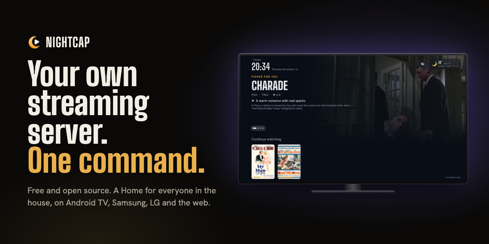
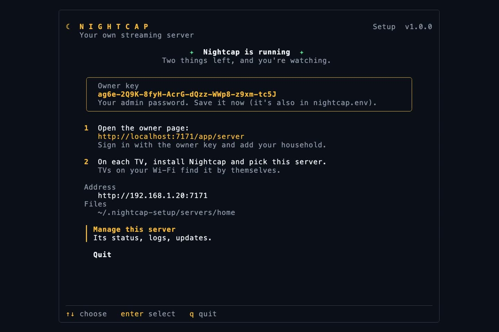
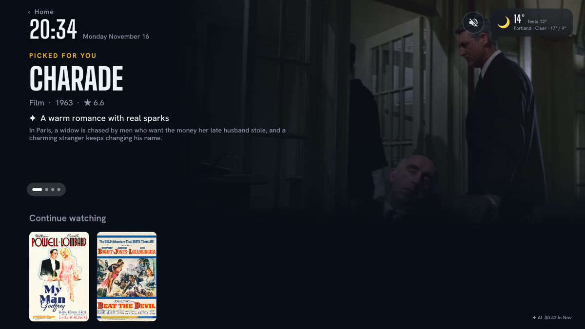
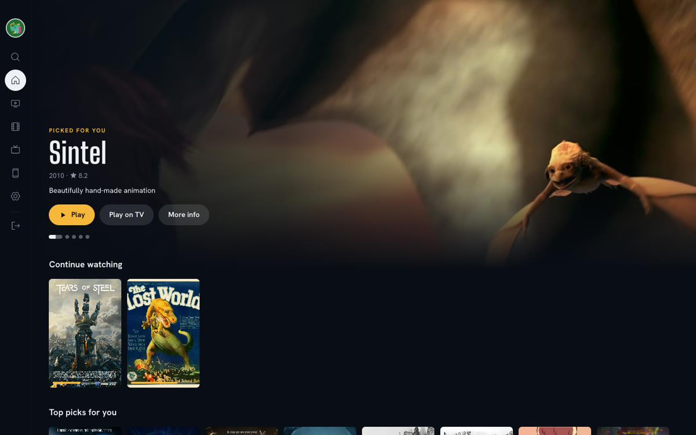
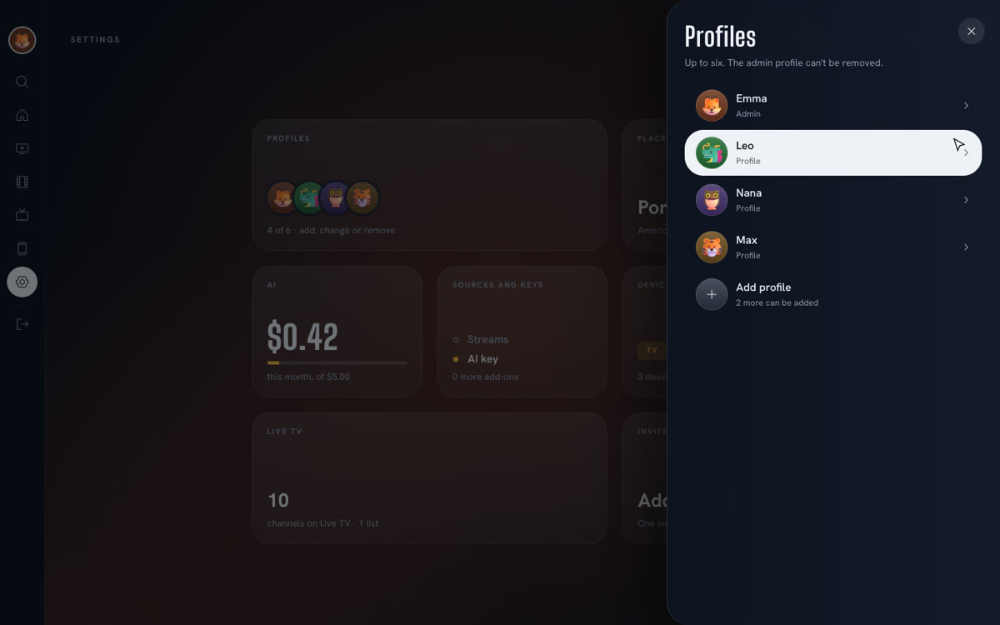

<p align="center">
  
</p>

<p align="center">
  <a href="https://github.com/chiragd03/nightcap/releases"></a>
  <a href="https://github.com/chiragd03/nightcap/stargazers"></a>
  <a href="LICENSE"></a>
</p>

<p align="center">
  <b>Nightcap is a free, self-hosted streaming system for the whole house.</b><br>
  One command sets up the server. Everyone at home gets their own Home on the TV, the laptop and the phone.
</p>

<p align="center">
  <a href="#install">Install</a> ·
  <a href="#on-your-tv">TV apps</a> ·
  <a href="#what-you-get">What you get</a> ·
  <a href="#where-your-films-come-from">Sources</a> ·
  <a href="ROADMAP.md">Roadmap</a> ·
  <a href="https://github.com/chiragd03/nightcap/releases">Releases</a>
  <!-- WEBSITE LINK: add the website (with Docs) here once the domain is set -->
</p>

---

## Install

```sh
curl -fsSL https://github.com/chiragd03/nightcap/releases/download/setup-v1.0.0/install.sh | sh
```

Then run `nightcap` and answer a few questions. On Windows, download the `.exe` from [Releases](https://github.com/chiragd03/nightcap/releases).

The setup is a guided screen in your terminal. It checks what your computer has, asks where to run the server, and shows everything back on one review screen. Nothing is made until you say so.

<p align="center"></p>

**What you need:** Docker (or `kubectl`, or `gcloud`) and a free [TMDB](https://www.themoviedb.org) API key for posters and details.

### Where it can run

| | Best for | You need | Cost |
|---|---|---|---|
| **This computer** (recommended) | Your home. An Android TV on your Wi-Fi finds it by itself. | Docker | Free (just electricity) |
| **Kubernetes** | Any cluster you already run | `kubectl` pointed at it | Free on your own hardware |
| **Google Cloud** | Watching away from home, with nothing running at home | `gcloud`, signed in, billing on | Usually free for a household. It sleeps when nobody watches, and the cost is shown before anything is made. |
| **Another machine** | A NAS or a spare box | Docker on that machine | Free |

Run `nightcap` again any time to see the server's status and logs, and to update, restart or stop it.

## On your TV

| TV | How |
|---|---|
| **Android TV / Google TV** (Android 9+) | Install the `.apk` from the newest `tv-v…` [release](https://github.com/chiragd03/nightcap/releases). It updates itself from your server. |
| **LG** (webOS 5+, 2020 on) | Install the `.ipk` from the newest `lg-v…` [release](https://github.com/chiragd03/nightcap/releases) with LG's Developer Mode. Extend the Developer Mode session in LG's app now and then, or the TV removes the app. |
| **Samsung** (Tizen 5.5+, 2020 on) | Download the package from the newest `samsung-v…` [release](https://github.com/chiragd03/nightcap/releases), sign it once for your TV with Tizen Studio (free), then install it in Developer Mode. Samsung only installs apps signed for that TV. |

**Joining a household.** At home, the Android TV app finds your server on the Wi-Fi and shows your households: pick one and you're in. Samsung and LG type the server's address once. For a server in the cloud, each TV joins once with an 8-character join code from the web app.

## What you get

<table>
  <tr>
    <td width="50%"></td>
    <td width="50%"></td>
  </tr>
  <tr>
    <td><b>A Home for each person.</b> Everyone picks their face on <i>Who's watching?</i> and gets rows built from what they watch, and every pick says why in one line.</td>
    <td><b>On the TV and the laptop alike.</b> The same Homes in the web app in any browser at home, and on your phone.</td>
  </tr>
</table>

- **Households and profiles.** Up to six profiles per household, each with its own history, languages and picks. One server can hold several households.
- **Smart Search.** Type a feeling, like "robots and big ideas", and get picks, each with its reason.
- **Play on TV.** Pick a film on your phone or laptop and press *Play on TV*. The TV asks once, then plays.
- **Live TV.** Your channel lists in one guide with logos and a live preview, events with more than one camera, and channel up and down on the remote.
- **A player that heals itself.** Sources are ranked by language and quality, dead files are skipped in seconds, and it picks up from the same second if a stream drops.
- **Bring your own AI, optional.** Add an AI key for picks and Smart Search, with a monthly limit you set. Nightcap works without one too.
- **Your server, your data.** Your household's watching stays on the server you run.

<p align="center"></p>

## Where your films come from

Nightcap doesn't host, sell or stream any films. What it plays comes from the sources your household sets up:

1. **Add-ons.** Any add-on in the open Stremio add-on format: paste its address and press *Test*. Up to 20 for streams and 20 for subtitles.
2. **Services you already use.** If you have an account with a link service, paste its key once and Nightcap sets up the rest for the household.
3. **Your own.** The add-on format is open, so anything you have the right to share, like your own media server, can become a source.

Only add sources you have the right to use.

## The code

This repository has the server ([`nightcap-server`](nightcap-server), Python), the web app with the Samsung/LG TV app ([`nightcap-web`](nightcap-web), React and TypeScript) the setup tool ([`nightcap-setup`](nightcap-setup), Go), the Android TV app ([`nightcap-tv`](nightcap-tv), Kotlin) and the Samsung/LG launcher ([`nightcap-tvweb`](nightcap-tvweb)). Each folder's README says how to run, build and test it. The setup tool and the TV apps' packages also come ready-built in [Releases](https://github.com/chiragd03/nightcap/releases).

## Roadmap, contributing and help

- **Roadmap:** what's being built next is in [ROADMAP.md](ROADMAP.md).
- **Questions and ideas:** open a [Discussion](https://github.com/chiragd03/nightcap/discussions).
- **Bugs:** open an [Issue](https://github.com/chiragd03/nightcap/issues/new/choose) with the form.
- **Contributing:** see [CONTRIBUTING.md](CONTRIBUTING.md). Everyone taking part follows the [Code of Conduct](CODE_OF_CONDUCT.md).
- **Security:** please report privately, as described in [SECURITY.md](SECURITY.md).

## Licence

Nightcap is free software under the [GNU Affero General Public License v3.0](LICENSE) (AGPL-3.0). You can use, study, change and share it. If you share a changed version, or run one for other people over a network, you must share your changes under the same licence.

---

<sub>This product uses the TMDB API but is not endorsed or certified by TMDB. Screenshots show open movies from the Blender Foundation (CC BY) and public-domain films; all titles and images belong to their owners.</sub>
